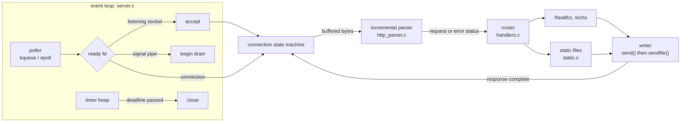

# c-http-server

[](https://github.com/bhavana-sanal/c-http-server/actions/workflows/ci.yml)
[](LICENSE)

An event-driven HTTP/1.1 static file server in C17, built on kqueue/epoll with no dependencies beyond libc.

## Features

- **Single-threaded, non-blocking event loop** over a thin poller layer: kqueue on macOS, epoll on Linux, picked at compile time.
- **Multi-process mode** (`-w N`): workers each own a listening socket bound to the same port with `SO_REUSEPORT`.
- **Incremental, zero-copy request parser**: a byte-level state machine that resumes wherever the previous `recv()` stopped. Parsed fields are slices of the connection buffer. Chunked bodies are decoded in place.
- **Strict HTTP/1.1 framing**: `Content-Length` and chunked request bodies, pipelining, `Expect: 100-continue`, and 400/413/414/431/501/505 for malformed or oversized input.
- **Keep-alive** with idle, request and write timeouts kept in a min-heap.
- **Graceful shutdown** on SIGINT/SIGTERM: stop accepting, finish in-flight responses, then exit.
- **Static files**:
  - traversal-proof path handling (encoded `%2e%2e` and escaping symlinks are rejected)
  - MIME types and zero-copy `sendfile()`
  - single `Range` requests (206/416)
  - `ETag`/`If-None-Match` and `Last-Modified`/`If-Modified-Since` (304)
  - `HEAD`, `index.html`, and optional HTML-escaped directory listings
- **Dynamic routes**: `/healthz`, and `/echo`, which returns the parsed request as JSON.
- **Access log** in Common Log Format.

## Quickstart

```sh
make                                   # builds build/c-http-server
./build/c-http-server -r ./public -p 8080
```

```
usage: c-http-server [-b addr] [-p port] [-r root] [-w workers] [-t seconds] [-a] [-q]
  -b addr     address to bind (default 127.0.0.1)
  -p port     port to listen on, 0 for any free port (default 8080)
  -r root     directory to serve (default .)
  -w workers  processes sharing the port via SO_REUSEPORT (default 1)
  -t seconds  idle, request and write timeout (default 5)
  -a          list directories that have no index.html
  -q          disable the access log
```

Requires a C17 compiler and make. CI builds and tests on Linux (gcc and clang) and macOS (Apple clang).

## Examples

```sh
curl -i localhost:8080/                          # serves ./public/index.html
curl -I localhost:8080/photo.jpg                 # HEAD: ETag, Last-Modified, Content-Length
curl -r 0-99 localhost:8080/video.mp4            # 206 Partial Content
curl -H 'If-None-Match: "<etag>"' -i localhost:8080/photo.jpg    # 304 Not Modified
curl localhost:8080/healthz                      # ok
curl -d 'hello' 'localhost:8080/echo?x=1'        # the request, as JSON
curl --path-as-is localhost:8080/../etc/passwd   # 400 Bad Request
```

`/echo` output, pretty-printed:

```json
{
  "method": "POST", "target": "/echo?x=1", "path": "/echo", "query": "x=1",
  "version": "HTTP/1.1", "remote": "127.0.0.1",
  "headers": [["Host", "localhost:8080"], ["User-Agent", "curl/8.7.1"], ["Accept", "*/*"],
              ["Content-Length", "5"], ["Content-Type", "application/x-www-form-urlencoded"]],
  "body": "hello"
}
```

Access log (stdout):

```
127.0.0.1 - - [02/Nov/2026:18:33:18 +0530] "GET /hello.txt HTTP/1.1" 200 6
127.0.0.1 - - [02/Nov/2026:18:33:18 +0530] "GET /hello.txt HTTP/1.1" 206 2
```

## Architecture



| File | Role |
| --- | --- |
| `src/main.c` | CLI, listening sockets, worker processes |
| `src/server.c` | event loop, connection state machine, timeouts, access log, `sendfile` shim |
| `src/poller.h`, `poller_kqueue.c`, `poller_epoll.c` | edge-triggered readiness, one backend per platform |
| `src/http_parser.c` | resumable request parser and framing rules |
| `src/http.c` | response serialization, HTTP dates |
| `src/handlers.c` | request-target splitting, routing, `/healthz`, `/echo` |
| `src/static.c` | path normalisation, file resolution, conditionals, ranges, MIME, autoindex |
| `src/timer_heap.c` | indexed binary min-heap of deadlines |
| `src/buf.c` | growable buffer with sticky allocation failure |

### Connection lifecycle

```mermaid
stateDiagram-v2
    [*] --> READING: accept
    READING --> READING: partial request (queue 100 Continue if asked)
    READING --> WRITING: request parsed, or parse error
    WRITING --> READING: keep-alive; pipelined bytes are kept
    WRITING --> CLOSING: Connection close, error response, or shutting down
    CLOSING --> [*]: peer closed, or timeout
    READING --> [*]: peer closed, or timeout
```



Every event on a connection calls one function, `conn_run()`. It flushes pending output, then does whatever the state needs, and repeats until a syscall returns `EAGAIN`. Edge-triggered notification is only correct if every path ends at `EAGAIN`, and this loop shape guarantees that. The same function runs for read and write events, so it doesn't need to know which one fired.

A connection handles one request at a time. While a response is being written it doesn't read. Once the response is out, bytes already buffered after the request are parsed next. This keeps pipelined responses in order without any extra bookkeeping.

## Design decisions and trade-offs

**Edge-triggered, single-threaded.** A connection is only touched from one thread, so there are no locks. Each fd is registered once for both directions and never re-armed, which avoids one `epoll_ctl` or `kevent` call per state change. To scale across cores, run more processes (`-w`) rather than threads.

**A parser that never re-scans.** Header parsers that search for `\r\n\r\n` re-scan the buffer after every read, and a client trickling one byte at a time makes that quadratic. This parser keeps its position, so each byte is examined once. Fields are `{pointer, length}` slices into the connection buffer, so nothing is copied or NUL-terminated. Chunked bodies are decoded in place: data is moved down over the chunk framing, so the decoded body ends up directly after the head. Unit tests feed every request one byte at a time and in random chunk sizes, and require the same results as parsing it in one piece.

**Strict where leniency is dangerous.** The parser refuses several things that RFC 9112 allows a server to refuse, because each one is a known request-smuggling or desync vector:

- bare-LF line endings (§2.2)
- whitespace between a field name and its colon (§5.1)
- `obs-fold` continuation lines (§5.2)
- `Content-Length` together with `Transfer-Encoding` (§6.3)
- `Transfer-Encoding` in HTTP/1.0 (§6.1)
- duplicate `Content-Length` or `Host`
- a missing `Host` in HTTP/1.1 (§3.2)

**Small fixed buffers.** Each connection has one fixed input buffer of about 20 KiB. A request head is limited to 8 KiB (431 beyond), the target to 4 KiB (414), and the decoded body to 8 KiB (413). The server serves files rather than accepting uploads, so this is enough. The fixed buffer is never reallocated, so the parser's slices stay valid for the whole request.

**Min-heap instead of a timer wheel.** The loop passes the time until the next deadline to `kevent`/`epoll_wait` as the timeout. An idle server therefore sleeps until something is actually due, instead of waking every tick to advance a wheel. Each timer stores its index in the heap, so moving or cancelling it costs O(log n). A wheel's O(1) only starts to matter at connection counts far beyond what one process here handles. One knob (`-t`) covers three cases:

- a fresh or keep-alive connection must deliver a complete request within `t` (slow-loris protection, since the deadline is not pushed back as bytes trickle in)
- a response must make write progress at least every `t`
- a closing connection may linger for at most `t`

**Lingering close.** Closing a socket with unread input makes the kernel send RST, and that can destroy a 413 or 400 response before the client reads it. Following RFC 9112 §9.6, the server half-closes instead, then reads and discards input until the client hangs up or the timeout fires.

**`sendfile` plus `TCP_NODELAY`.** File bodies go from the page cache to the socket without passing through user space. Linux and macOS have different `sendfile` signatures and report partial writes differently, so `send_file()` in `server.c` wraps both. Headers and file are separate writes, so Nagle's algorithm would hold back the last partial segment until the client's delayed ACK. Disabling Nagle avoids that delay.

**Workers with `SO_REUSEPORT`.** The parent binds all sockets before forking: the first resolves port 0, and the others join it. Bind errors therefore surface immediately, and `-p 0` works with workers. On Linux the kernel spreads new connections across the sockets. On macOS, all test connections went to the same worker, so extra workers add no throughput there.

**Signals through a self-pipe.** The handler only writes a byte to a pipe that the poller watches. A signal arriving just before `kevent`/`epoll_wait` therefore can't be lost. The `kqueue`-only `EVFILT_SIGNAL` and Linux-only `signalfd` would each have needed a separate implementation.

**Deferred frees.** One poll batch can hold both a read and a write event for the same connection. A connection closed while handling the first event therefore goes on a list that is freed only after the batch.

## Security notes

- **Path traversal.** The path is percent-decoded *before* `.`/`..` segments are resolved, so `%2e%2e%2f` is treated the same as `../`. Climbing above the root is rejected with 400, as is `%00`. The result is then passed through `realpath()` and must still lie under the canonical root, so a symlink pointing outside is refused with 403. Symlinks that stay inside the root work.
- **Race window.** There is a check-then-open race: someone who can rename paths inside the root at the right moment could swap a directory for a symlink. The server assumes the document root is not writable by untrusted users. `openat2(RESOLVE_BENEATH)` would close this gap on Linux.
- **Dotfiles are served.** There is no hidden-file filter, so don't keep secrets under the root.
- **Directory listings** HTML-escape names and percent-encode links, so a file named `<script>.html` is displayed as text.
- **Log injection.** Method and target can't contain control characters (the parser rejects them), and quotes and backslashes are escaped in the access log, so one request can't forge a log line.
- **Resource limits.** Request size limits are described above. Every connection has a deadline. There is no cap on concurrent connections beyond the fd limit, and no per-client rate limiting. If `accept` hits `EMFILE`, pending connections wait until the next one arrives. Put a reverse proxy in front of anything internet-facing.
- **No TLS.** The default bind address is `127.0.0.1`.

## Testing

```sh
make test     # unit tests + integration tests
make asan     # the same, built with -fsanitize=address,undefined
make fuzz     # libFuzzer on the parser (needs clang with libFuzzer, e.g. on Linux)
```

**Unit tests** (`tests/test_*.c`, no framework):

- table-driven parser cases for valid requests, every error status and the size limits
- split-point invariance: every case and a mixed pipeline are fed whole, byte-by-byte, and in 300 random chunkings each, and the resulting transcripts must match
- path normalisation, `Range` parsing, MIME lookup, and all three HTTP date formats
- a randomized model check of the timer heap

**Integration test** (`tests/integration.sh`) starts the server on an ephemeral port. It talks to it with curl and with a small raw-socket client (`tests/rawclient.c`) that can send malformed bytes and split a request across TCP segments. It covers:

- keep-alive reuse, pipelining, a request split across packets, and HTTP/1.0 close semantics
- the idle timeout
- 304 via ETag and via date, 206/416, and a 16 MiB download plus a 2 MB range, compared by SHA-256
- encoded and unencoded traversal, symlink escape, directory redirect, and autoindex escaping
- chunked bodies with trailers and `100-continue`
- every error status, and the access log format
- graceful shutdown: SIGTERM during a rate-limited download must let it finish intact while new connections are refused
- the multi-worker mode

Under `make asan` on Linux, the server must also exit cleanly from LeakSanitizer. CI runs all of this on Ubuntu (gcc and clang) and macOS, plus a 60-second fuzzing run. The fuzz target (`tests/fuzz_parser.c`) checks for memory errors. It also checks that parsing an input whole and parsing it split at a fuzzer-chosen byte give the same results. Apple's clang doesn't ship libFuzzer, so fuzzing runs in CI on Linux.

### Performance

The only numbers here are ones I measured, on one machine. Treat them as a sanity check, not a benchmark: ApacheBench is single-threaded and ran on the same laptop, so it is likely the bottleneck for the `/healthz` case.

Setup: Apple M4 MacBook Air (10 cores, 16 GB), macOS 27, one server process, access log off (`-q`). Each line is three runs of `ab -k -c 50 -n 200000`.

| Request | Requests/s |
| --- | --- |
| `GET /healthz` | 225k – 246k |
| `GET /1k.bin` (1 KiB static file) | 34k – 37k |

The static path is dominated by per-request `realpath()`, `stat`, `open` and `sendfile` calls. Caching open file descriptors would be the next step. To reproduce:

```sh
./build/c-http-server -q -r ./public &
ab -k -c 50 -n 200000 http://127.0.0.1:8080/healthz
wrk -t4 -c100 -d10s http://127.0.0.1:8080/healthz     # if you have wrk
```

## Limitations and what's next

- **TLS**: terminate in a proxy today. The next step would be wrapping reads and writes behind a small transport interface backed by OpenSSL or BearSSL.
- **HTTP/2**: needs a framing layer, HPACK and stream multiplexing; this codebase's per-connection state machine would become per-stream.
- Request bodies larger than 8 KiB: stream them to handlers instead of buffering.
- Multi-range requests (`multipart/byteranges`) and `If-Range`. Today the server falls back to a full 200, which the RFC allows.
- A cache of open file descriptors and stat results; `openat2(RESOLVE_BENEATH)` on Linux.
- A per-connection work budget, so one aggressive pipelining client can't monopolise a loop iteration.
- Respawning workers that die.
- Porting `sendfile` to FreeBSD, whose signature differs again. The kqueue backend already fits.

## License

[MIT](LICENSE)
